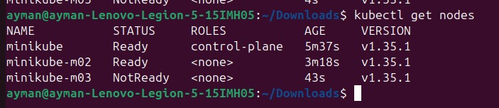
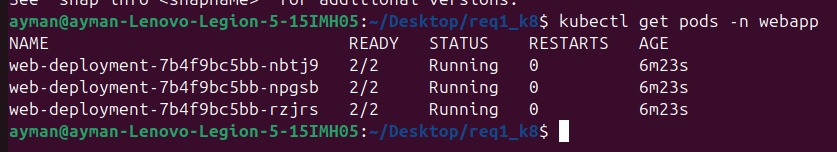
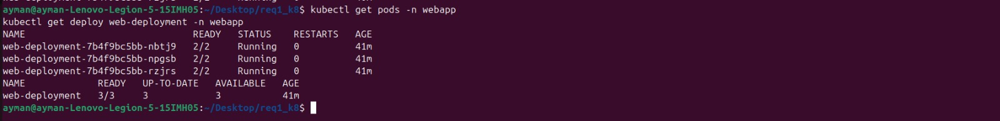
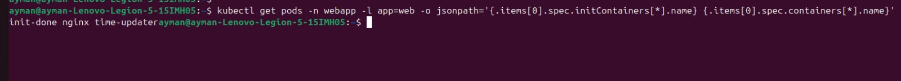
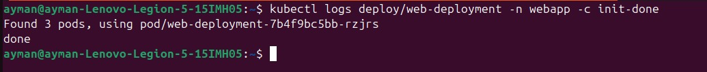
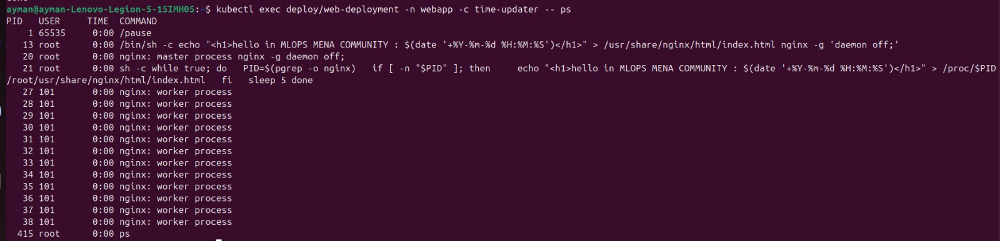

# Task-1: Init Container & Sidecar

## What I did
I ran an nginx "hello" page on a 3-node minikube cluster (Calico). Each Pod has 3 containers:

- **init-done**: prints `done` and exits. The others start only after it succeeds.
- **nginx**: writes the page with the current time and serves it on port 80.
- **time-updater**: updates the time on the page every 5 seconds.

The Pods have no volumes.

## Files
- `namespace.yaml`: creates the `webapp` namespace
- `deployment.yaml`: the Deployment (3 replicas)

## Steps and screenshots

### 1. Create the cluster
`minikube start --nodes 3 --cni=calico --cpus 2 --memory 2200`, then `kubectl get nodes`:

### 2. Deploy
`kubectl apply -f namespace.yaml`, `kubectl apply -f deployment.yaml`, then `kubectl get pods -n webapp`:

### 3. The page in the browser
`kubectl port-forward -n webapp deploy/web-deployment 8080:80`, then open http://localhost:8080:

After 5 seconds, refreshed. The time changed:

### 4. Make the init container fail
I changed the init command to `echo 'init failed'; exit 1` and ran `kubectl apply -f deployment.yaml`.

The new Pod is stuck in `Init:CrashLoopBackOff`, and the 3 old Pods are still running:

`kubectl describe pod <new-pod> -n webapp` shows `Exit Code: 1`:

**Answers**
- **Status of the new Pod:** `Init:CrashLoopBackOff`.
- **Do nginx and time-updater start?** No, because the init container must succeed first.
- **Is the page still working?** Yes. Kubernetes keeps the 3 old Pods running until the new one is ready, and it never gets ready.

### 5. Fix it
I changed the init command back to `echo done` and applied `deployment.yaml` again. All 3 Pods are running again:

## Verification

**Container names**

`kubectl get pods -n webapp -l app=web -o jsonpath='{.items[0].spec.initContainers[*].name} {.items[0].spec.containers[*].name}'`

**Init container succeeded**

`kubectl logs deploy/web-deployment -n webapp -c init-done`

**Sidecar sees nginx**

`kubectl exec deploy/web-deployment -n webapp -c time-updater -- ps`

**Time updates**

`kubectl exec deploy/web-deployment -n webapp -c nginx -- cat /usr/share/nginx/html/index.html`

**No volumes**

`kubectl get deploy web-deployment -n webapp -o jsonpath='{.spec.template.spec.volumes}'`

