# Task 2: FastAPI + MySQL on Kubernetes

A FastAPI guestbook (2 replicas) with one MySQL server on minikube.
MySQL data is stored on a PV/PVC, settings are in a ConfigMap, credentials are in a Secret, and the app is exposed through an Ingress.

## Files

| File | Content |
|------|---------|
| `02-namespace.yaml` | Namespace `webapp-stack` |
| `03-secret.yaml` | Secret `mysql-secret` |
| `04-configmap.yaml` | ConfigMap `webapp-config` |
| `05-pv-pvc.yaml` | PV `mysql-pv` and PVC `mysql-pvc` |
| `06-mysql.yaml` | MySQL Deployment + Service |
| `07-webapp.yaml` | App Deployment + Service |
| `09-ingress.yaml` | Ingress `webapp-ingress` |

## What I did

```bash
# 1. Build and load the images
minikube start
chmod -x mysql/initdb/01-setup.sh
docker build -t webapp-api:task2 ./webapp
docker build -t webapp-mysql:task2 ./mysql
minikube image load webapp-api:task2
minikube image load webapp-mysql:task2

# 2-7. Apply the yaml files in order
kubectl apply -f 02-namespace.yaml
kubectl apply -f 03-secret.yaml
kubectl apply -f 04-configmap.yaml
kubectl apply -f 05-pv-pvc.yaml
kubectl apply -f 06-mysql.yaml
kubectl apply -f 07-webapp.yaml

# 8. Ingress controller
minikube addons enable ingress

# 9. Ingress
kubectl apply -f 09-ingress.yaml

# 10. Open the app
kubectl port-forward -n ingress-nginx svc/ingress-nginx-controller 8080:80
```

## Verification

**1. Images loaded**
```bash
minikube image ls
```
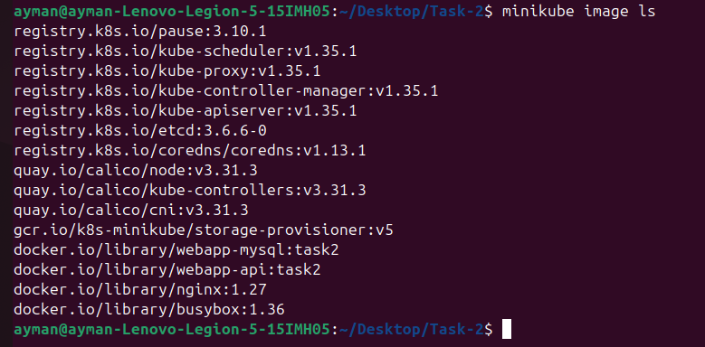

**2. Secret and ConfigMap**
```bash
kubectl get secret mysql-secret -n webapp-stack
kubectl get configmap webapp-config -n webapp-stack
```
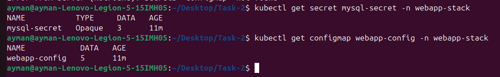

**3. PV and PVC bound**
```bash
kubectl get pv mysql-pv
kubectl get pvc mysql-pvc -n webapp-stack
```
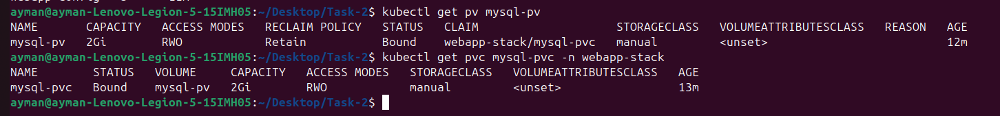

**4. Deployments ready**
```bash
kubectl get deploy -n webapp-stack
```
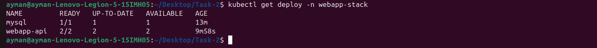

**5. MySQL on node minikube-m02**
```bash
kubectl get pods -n webapp-stack -l app=mysql -o wide
```
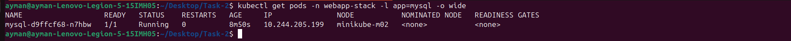

**6. App environment variables**
```bash
kubectl exec -n webapp-stack deploy/webapp-api -- env
```
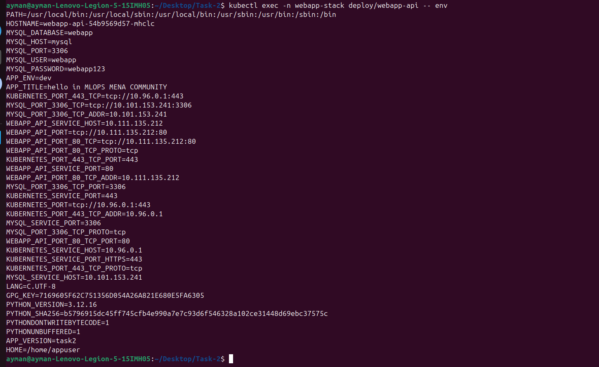

**7. Default data in MySQL**
```bash
kubectl exec -n webapp-stack deploy/mysql -- sh -c 'mysql -uroot -p"$MYSQL_ROOT_PASSWORD" -e "SELECT * FROM webapp.messages"'
```
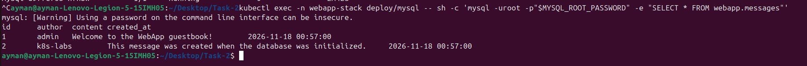

**8. Ingress**
```bash
kubectl get ingress webapp-ingress -n webapp-stack
```
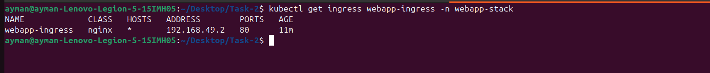

**9. App info**
```bash
curl http://localhost:8080/api/info
```
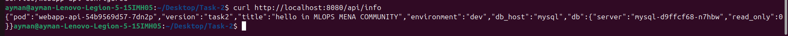

**10. Write a message**
```bash
curl -X POST http://localhost:8080/api/messages -H "Content-Type: application/json" -d '{"author":"student","content":"hello"}'
```
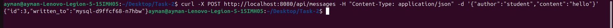

**11. Read messages**
```bash
curl http://localhost:8080/api/messages
```
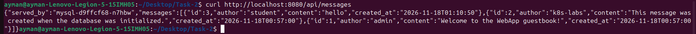

**12. Data survives a restart**
```bash
kubectl delete pod -n webapp-stack -l app=mysql
curl http://localhost:8080/api/messages
```
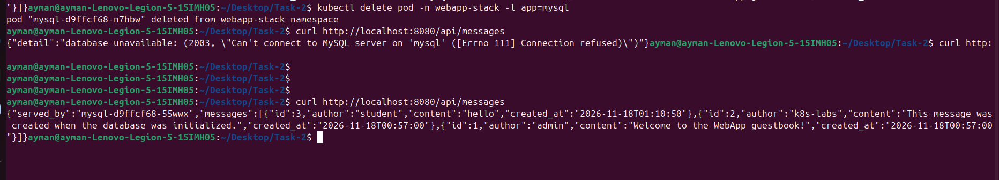

The message `hello` is still there after the new MySQL Pod starts, so the data is stored on the PV.
